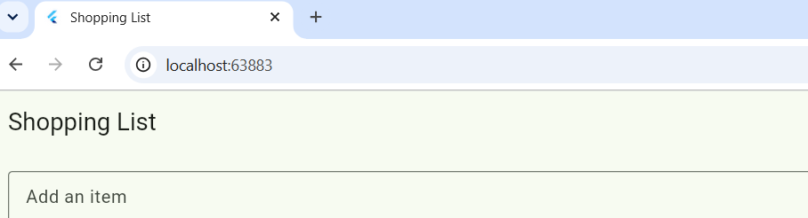

# Shopping List

My Flutter app: add items, mark them as bought, delete them, and much more.

## Features

1. **Empty state**: an empty list shows "Your list is empty" instead of a blank page.
2. **Quantities**: every item has a quantity with − and + buttons; it never goes below 1.
3. **No duplicates**: adding an item that already exists (any capitals or spaces) raises its quantity and shows "Milk is already on the list: now ×2".
4. **Undo**: deleting shows "removed" with an Undo button that puts the item back in the same place.
5. **Filters**: All / To buy / Bought chips; in All the bought items sit at the bottom; "Nothing here" when a filter is empty.
6. **Item details**: long-press an item to edit its name, note and category (Food, Drinks, Home); Save keeps the changes, the back arrow changes nothing, and an empty name is refused.

## Screenshots

### The list

### An item bought

### An empty item refused

### Quantities

### Undo message

### Bought filter

### Item details

## Think

**1. In part 5, why does deleting by index remove the wrong item when a filter is on? How did you fix it?**
With a filter on, the screen shows `shown`, a smaller list made from `items`. Row 0 on the screen is then not item 0 of `items`, so `items.removeAt(index)` removed a different item, with no error message. I fixed it by deleting the item itself (`items.remove(item)`) instead of using a screen position.

**2. Why did you have to remove `final` from `name`? Why is `final` still a good choice for most fields?**
`final` means a field can be set once and never changed. The details screen must rename an item, which means assigning a new value to `name`, so it cannot be final. For most fields `final` is still good because it prevents accidental changes, so bugs are easier to find and the code is easier to understand.

**3. Why did you need a hot restart after adding `quantity` to `Item`, when a save was enough for everything else?**
A hot reload keeps the objects already in memory. The existing `Item` objects were created with the old shape of the class, without `quantity`, so the new field could not be added to them. A hot restart throws the state away and starts the app again, so every `Item` is created with the new class.

**4. The details screen changed the item, but the list only showed it after `setState` in `.then`. Why? What does this tell you about how Flutter decides when to redraw?**
The details screen changed the data, but Flutter only redraws a screen when `build` runs again, and that happens when `setState` is called on that screen's own State. The list's State did not know anything had changed, so it kept showing the old picture. This tells me that Flutter does not watch my data: I have to tell it with `setState` whenever something the screen shows has changed.
